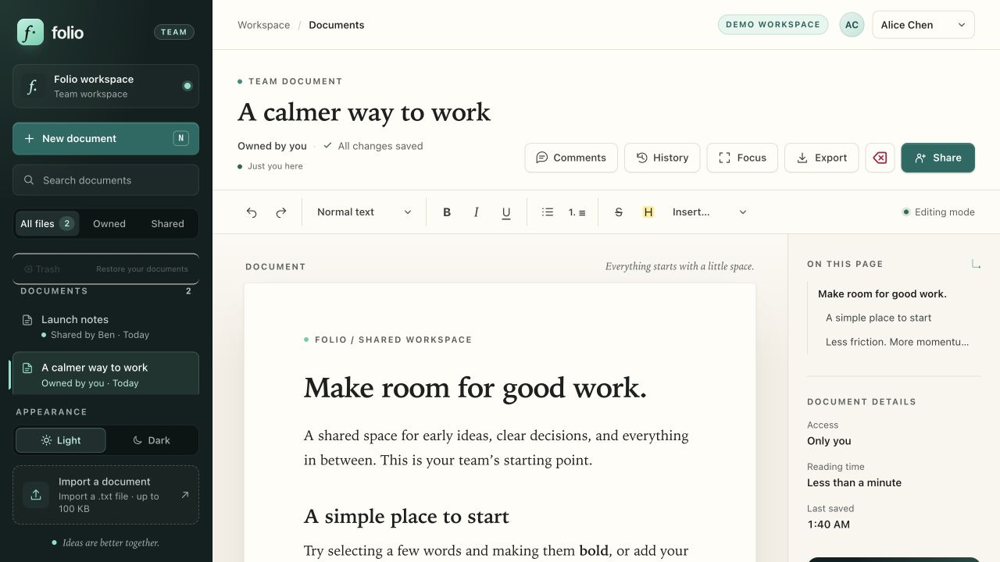
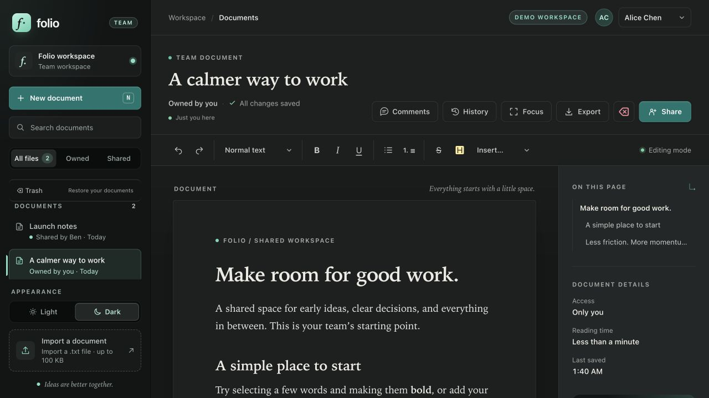
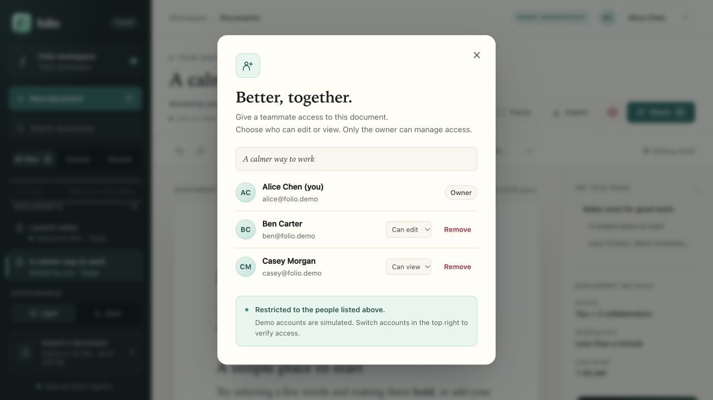
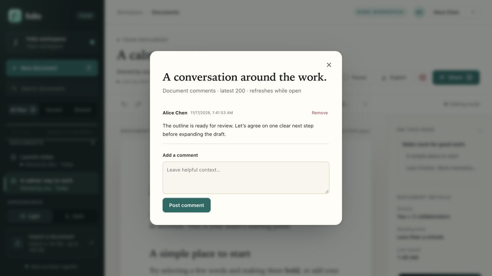
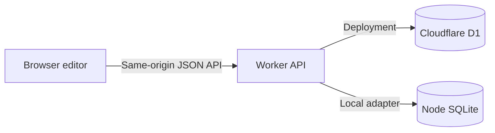

<div align="center">

# Folio

### A collaborative workspace for thoughtful writing.

Write, share, review, and recover documents in one focused workspace.

[](https://github.com/ankitpanda226/folio/actions/workflows/ci.yml)


[Features](#features) · [Screenshots](#screenshots) · [Quick start](#quick-start) · [Architecture](#architecture) · [Testing](#testing)

</div>



Folio is a full-stack document editor built with vanilla JavaScript, a Cloudflare Worker API, and SQLite-compatible storage. It brings together rich-text writing, persistent autosave, permission-based sharing, comments, version history, and recoverable Trash—with **no runtime npm dependencies**.

## Features

| Area | What you can do |
| --- | --- |
| **Write and format** | Create and rename documents; use headings, lists, bold, italic, underline, strikethrough, highlights, code blocks, callouts, dividers, and symbols. |
| **Save and reopen** | Autosave after a short pause, reopen saved documents, and retain the visible draft when a save fails. |
| **Import** | Upload a UTF-8 `.txt` file up to **100 KB** and turn it into a new editable document. |
| **Share** | Grant editor or viewer access, change roles, and revoke access through owner-controlled sharing. |
| **Review** | Discuss documents in comments, preview saved versions, and restore an earlier version as a new save. |
| **See activity** | See who is viewing or editing through presence indicators that refresh every 10 seconds. |
| **Recover** | Move owned documents to Trash and restore their content, comments, history, and sharing settings. |
| **Export** | Download HTML or Markdown, or use browser **Print → Save as PDF**. |
| **Personalize** | Switch between Light and Dark, open Focus mode, and navigate documents through a responsive sidebar or menu. |

## Screenshots

These captures show the local app with seeded demo accounts and sample content.

### Light and Dark

<table>
  <tr>
    <td width="50%"><p align="center"><strong>Light</strong> · warm ivory and deep teal</p></td>
    <td width="50%"><p align="center"><strong>Dark</strong> · charcoal and mint</p></td>
  </tr>
</table>

### Sharing and document discussions

<table>
  <tr>
    <td width="50%"><p align="center"><strong>Clear access roles</strong> · owner, editor, and viewer</p></td>
    <td width="50%"><p align="center"><strong>Document comments</strong> · keep feedback beside the work</p></td>
  </tr>
</table>

## Quick start

**Requirements:** Node.js **22.13+**. No dependency installation is required for the app, build, or automated tests.

```sh
git clone https://github.com/ankitpanda226/folio.git
cd folio
npm run dev
```

Open **http://127.0.0.1:4173**.

The local server applies pending migrations and creates `.local/folio.sqlite`. Documents persist across refreshes and server restarts.

Optional configuration:

```sh
PORT=4200 npm run dev
FOLIO_DB=.local/my-workspace.sqlite npm run dev
```

Use a database path inside an existing directory. Stop the server before resetting a disposable local database.

## Try the workflow

1. Start as **Alice Chen**, create a document, and give it a title.
2. Write and format a paragraph. Wait for **All changes saved**, then refresh and reopen it.
3. Choose **Import a document** to upload `sample-import.txt`. On a narrow screen, open the documents menu first.
4. Open **Share** and give **Ben Carter** editor or viewer access. Switch accounts to inspect the recipient’s experience.
5. Add a comment as an editor and open **History** to preview earlier saves. Restoring creates a new version.
6. As the owner, revoke access or choose **Move document to Trash**. Restore it from **Trash** in the documents menu.

### Demo accounts and permissions

| Role | Access |
| --- | --- |
| **Owner** | Edit, comment, restore document versions, export, manage sharing, and move documents to/from Trash. |
| **Editor** | Read, edit, comment, restore document versions, and export. |
| **Viewer** | Read, view comments and history, and export. |

The three seeded accounts are **Alice Chen**, **Ben Carter**, and **Casey Morgan**, with fake `@folio.demo` email labels.

**Authentication is simulated.** The account selector sends an `x-demo-user` header; a caller can select any seeded identity. Document permissions are enforced server-side within that demo model. Use authenticated sessions before storing real private documents.

Restoring a trashed document also restores access for previously shared teammates. Nothing is permanently deleted.

## Architecture



| Layer | Implementation |
| --- | --- |
| Interface | Vanilla JavaScript, semantic HTML, CSS themes, and inline SVG icons. |
| Editor | `contenteditable`, browser formatting commands, and a restricted document-tree representation. |
| API | Cloudflare Worker with input validation, prepared SQL, access checks, and version-checked writes. |
| Persistence | Cloudflare D1 in deployment; Node’s built-in SQLite for local development and tests. |
| Automation | GitHub Actions runs tests, builds the Worker, and validates the generated artifact. |

### Engineering decisions

- **Safe content representation:** the server canonicalizes an allowlisted JSON tree and strips attributes. The client renders DOM nodes and text instead of arbitrary saved HTML.
- **Conflict-aware saving:** sequential autosaves carry the last known version. Stale saves return `409` instead of overwriting newer work; the visible draft remains available for recovery.
- **Transactional history:** a content update and its snapshot commit together. Failed snapshot storage rolls back the write, and restoring a version creates a new snapshot.
- **Recoverable cleanup:** Trash marks a document as deleted, excludes it from active access, and clears presence while retaining the data needed to restore it.

See [ARCHITECTURE.md](ARCHITECTURE.md) for data-model details and implementation tradeoffs.

## Testing

```sh
npm test
npm run build
npm run validate
```

The automated suite contains **21 tests** covering:

- Permission grants, role restrictions, revocation, and rejected direct API requests.
- Stale saves, input validation, safe rich-text handling, file-import limits, and persistence after reopening SQLite.
- Comments, presence expiry, version snapshots, rollback, and legacy baseline snapshots.
- Markdown formatting and escaping, plus owner-only Trash/Restore with retained data.

`npm run build` produces `dist/server/index.js`. Validation imports that artifact and checks its `default.fetch` handler.

The optional `tests/browser-check.mjs` script requires a separately installed Playwright environment and a running local server. It is not included in `npm test`.

## Project structure

```text
app/                  Editor UI, API, styles, and Markdown conversion
scripts/              Local server, SQLite adapter, build, and validation
drizzle/              Three ordered SQL migrations and their journal
tests/                API, collaboration, export, and recovery tests
docs/images/          Screenshots used in this README
.github/workflows/    Automated verification
```

## Deployment

Build the standalone Worker, configure a D1 database with the binding name **`DB`**, apply all three migrations in `drizzle/meta/_journal.json` order, and deploy `dist/server/index.js` with your Cloudflare tooling.

The repository contains no production database, credentials, or hosting project identifiers. Provider usage limits still apply even though the app has no runtime npm dependencies.

## Current limitations

- Presence indicates activity; document text is **not synchronized live** between tabs. Conflicts require manual recovery.
- The browser-based editor has limited native undo coverage for structural insertions and highlighting. A maintained editor engine would improve production readiness.
- Comments belong to the document rather than specific text ranges. The UI lists the latest **100 versions** and **200 comments**.
- PDF uses native browser printing. Native PDF output and a complete phone/browser/IME matrix need broader verification.
- Revocation cannot remove text that someone has already loaded or downloaded. There is no permanent-delete operation or offline draft queue.

## Development notes

Developed with AI assistance: **Codex** supported implementation and testing, and **Lovable** contributed the visual design integrated with the document API.

Next priorities: production authentication, a maintained editor engine, durable local draft recovery, and broader browser coverage.
